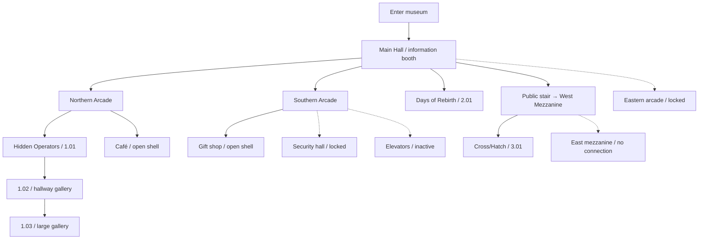

# The first visit

The current beginning is an exploration route, not an implemented puzzle sequence. All five gallery shells are open at the start. There is no mandatory order, completion condition, ending, or hidden key.

## Suggested first walk

1. Enter the southern part of the main hall, looking north toward the great window and bronze sculpture.
2. Visit the circular information booth. Operate the monitor and follow its wire to the lamp. Consult the visitor map.
3. Approach the window, then turn left into the Northern Arcade. Read the entrance wall for Hidden Operators. Visit its boxy first gallery, hallway gallery, and large third gallery. Return the same way; inspect the café opposite and the wall map.
4. Return through the main hall. Near the southern stair, enter Days of Rebirth on the west side. Its first room is empty.
5. Cross the hall into the shorter Southern Arcade. Look through the gift-shop glazing, enter the shop, inspect the elevators, and identify the separate locked security passage.
6. Climb the public stair. Walk along the west mezzanine and enter Cross/Hatch. Explore the freestanding wall arrangement and look back into the main hall.
7. Return freely to any open area. The east arcade and east mezzanine remain closed.

## Route graph

The linked [visual progression diagram](../floor-plans/progression.svg) is a static export of the current relationships. The Mermaid source below is also maintained in `progression.mmd`.

Solid arrows indicate available travel; open paths are reversible. Dashed arrows are visible future boundaries, not unlockable goals. The east mezzanine line represents its relationship to public upper circulation; it is not a bridge or a door at the top of the stair.

## Future progression design

For every later gate, document the evidence required, the reasoning required, where the answer is submitted, the state change, the return route, and why the player cannot get stranded. Distinguish a true mechanical prerequisite from an optional clue or a suggested route. Do not silently convert a decorative hub work into a required puzzle.
