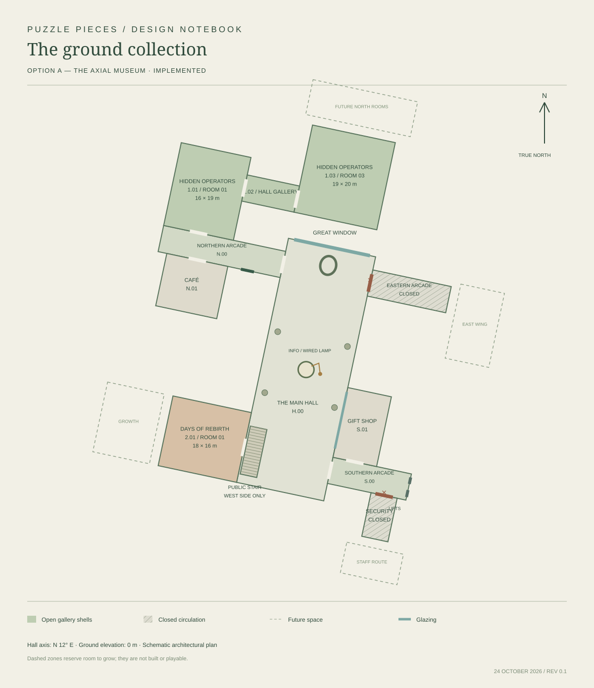
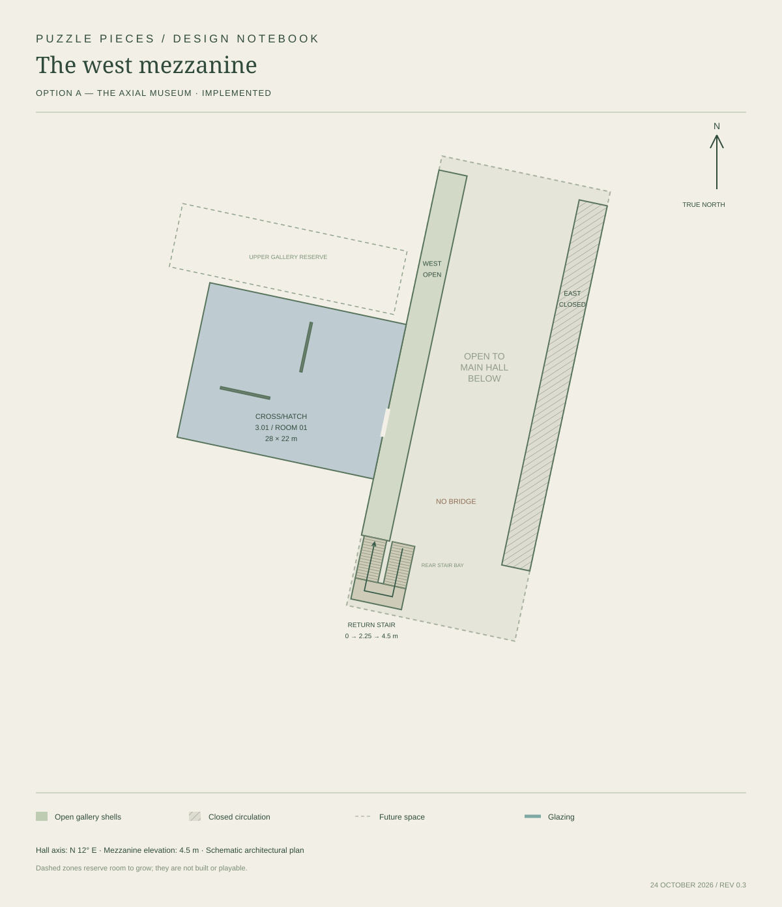
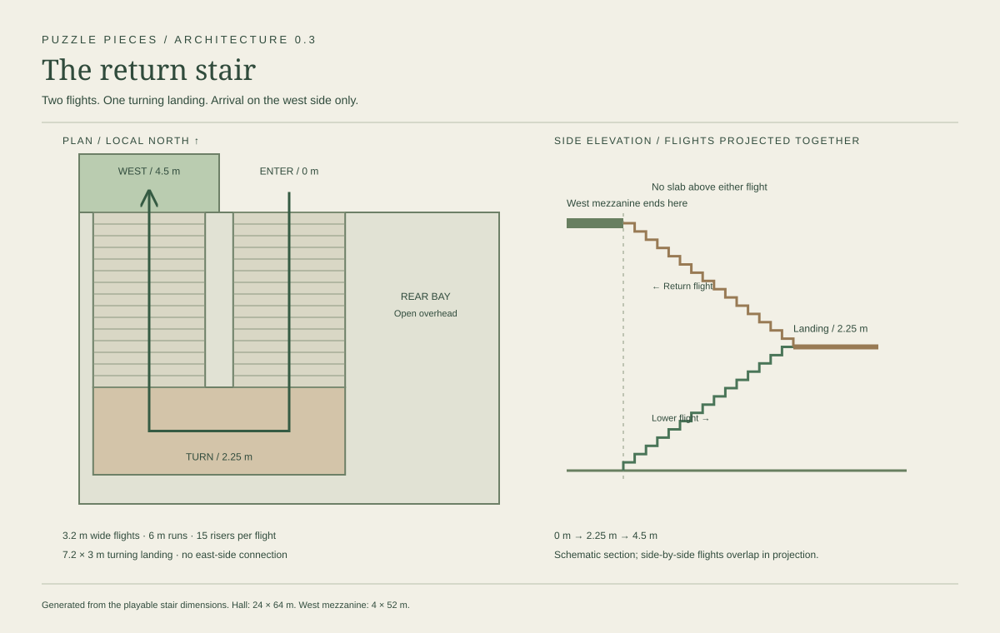

# Floor plans — current building and alternative

Both plans use a long north/south hall tilted 12° east of true north, a great window at the north/northeast end, a south/southwest stair, the same three exhibits, and separate west/east mezzanines. Dashed expansion bands are proposals, not current rooms. Room dimensions are schematic.

## Current revision / 0.3

The implemented hall is now 24 × 64 m, with a 5.8 m information counter and a rear return stair. Both floor drawings and the in-game visitor map use the updated dimensions. The stair section makes the turning landing and clear overhead space explicit.

## Option A — the axial museum — implemented

[Ground-floor author plan](option-a.svg) · [Visitor ground plan](option-a-ground.svg) · [West mezzanine plan](option-a-upper.svg)

The northern arcade travels left from the window and puts Hidden Operators opposite the café. Its first room leads through a narrow second gallery into a larger third room behind the northern end of the hall. The third room can continue north/east. Days of Rebirth occupies the west side near the stair; the shorter southern arcade and gift shop sit opposite it. Cross/Hatch extends west from the upper gallery.

Advantages: the main axis stays easy to recognize; the entrance sequence teaches the difference between a room and a corridor; expansion space is generous. Tradeoff: Hidden Operators currently has a retraced return route rather than a loop. This can be changed after the puzzle structure is known.

## Option B — the returning wing — alternative only

[Ground-floor author plan](option-b.svg) · [Mezzanine plan](option-b-upper.svg)

The main hall, southern facilities, and public stair retain their relationships. The northern arcade is longer, with the café opposite the first exhibit entrance. Hidden Operators' second room runs west from the first; its third room returns toward the arcade, creating a loop. Cross/Hatch remains a single large upstairs room, with a wider future upper wing reserve.

Advantages: less retracing, more chances for cross-room sightlines and an exhibit-wide return clue. Tradeoffs: larger western footprint and a loop that may reveal relationships earlier than intended. This option is documented but is not selectable in the playable build.

## Comparison

| Question | Option A | Option B |
| --- | --- | --- |
| Hidden Operators route | Boxy room → hall gallery → large room; return the same way | Boxy room → hall gallery → large room → arcade loop |
| Expansion emphasis | North and northeast beyond Room 03 | West and northwest beyond the return wing |
| Café relationship | Opposite first exhibit entrance | Opposite first exhibit entrance |
| Days of Rebirth | West of south hall, opposite southern arcade | Same |
| Upper access | Rear return stair to west only | Same |
| Current implementation | Yes | No; design alternative |

The plans distinguish open room shells, locked circulation, vertical circulation, fixtures, and future space. The upstairs plan is separate to avoid confusing the two overlapping floors.
